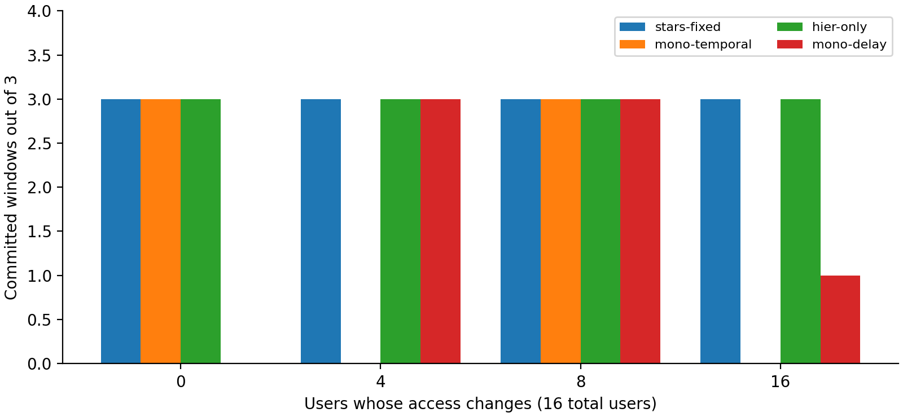

# STARS-RL Orchestration

An independent Python implementation of stability-aware security function chain orchestration in LEO satellite networks, based on STARS, with an RL extension for selecting stability-weight ratios.

The optimizer chooses user access, satellite/ground-station egress, function instances and continuous CPU allocations. Temporal repair and two optimization stages handle changing connectivity. Every committed deployment passes independent constraint and objective validation.

## Results at a glance

| Experiment | Measured outcome |
|---|---|
| 32 users / 8 authored satellites | Three validated windows; four access switches and eight function-host moves. |
| 64 users / 16 authored satellites | First window exceeded the ten-second decision budget; no deployment committed. |
| Repeated 16-user handover | STARS completed 3/3 episodes; summed decision time 1.09–1.92 s per episode. Hierarchy-only performed similarly; temporal monolithic took 9.88–10.96 s. |
| Resource pressure | Tested both feasible and infeasible user loads, CPU capacities, throughput demands and delay limits. |
| Physical families | All five predetermined seeds retained per family; none passed all fourteen snapshot checks. Two initially passing development traces were attempted through the optimizer: one timed out and one was infeasible. |
| RL action sensitivity | Constructed cases show a 1.9 return difference and reversal of the preferred weight. No trained-policy superiority is established. |

These are case-study measurements, not claims of universal improvement. Authored connectivity experiments and physical orbit generation are distinct. The implementation includes learning/evaluation software, but native training and scientific held-out evaluation remain blocked by readiness requirements.

**Read the evidence:** [selected findings](experiments/SELECTED_FINDINGS.md), [complete summary](experiments/report-evidence/SUMMARY.md), [all measured outcomes](experiments/results/final-matrix/authored-results.csv), [physical seed audits](experiments/results/final-matrix/physical-results.csv), and [experiment protocol](experiments/README.md).



## Requirements and setup

- Python 3.11 and a compatible PySCIPOpt wheel; no Gurobi license or GPU is needed.
- Windows full-suite and quickstart execution have been verified locally.
- Hosted Windows and Ubuntu fast checks passed at `5b6725f`. Hosted full checks and Colab are not established by that evidence.

From the repository root in PowerShell:

```powershell
python -m venv .venv
.\.venv\Scripts\python.exe -m pip install --only-binary=:all: -r requirements-build-lock.txt
.\.venv\Scripts\python.exe -m pip install --only-binary=:all: -r requirements-lock.txt
.\.venv\Scripts\python.exe -m pip install --no-build-isolation --no-deps -e .
.\.venv\Scripts\python.exe -m pip check
.\.venv\Scripts\python.exe -m stars_rl.cli doctor --solver
```

For POSIX commands and detailed troubleshooting, see [the usage reference](docs/USAGE.md). Matplotlib is optional for rendering saved figures and may use a separate interpreter.

## Live handover demo

```powershell
.\.venv\Scripts\python.exe examples/demo.py --output runs/new-handover
Start-Process .\runs\new-handover\index.html
```

This solves a one-user, two-function, three-window authored handover and writes an HTML explanation, summary and raw solver/validation records. Initialization counts as zero changes. Use a new output directory for each invocation.

For sixteen simultaneous users with four satellites:

```powershell
.\.venv\Scripts\python.exe -m stars_rl.cli generate --scenario experiments/inputs/authored-16users-v1.yaml --output runs/new-16-trace.json
.\.venv\Scripts\python.exe -m stars_rl.cli simulate --trace runs/new-16-trace.json --output-root runs --run-id new-16 --method stars-fixed --rho 0.5 --budget 10
.\.venv\Scripts\python.exe -m stars_rl.cli validate --run-dir runs/new-16/stars-fixed
```

The visibility changes are authored; placement and CPU allocation are solved. The fixed-ratio commands do not train or invoke a learned policy. Other methods are `mono-delay`, `mono-temporal` and `hier-only`; these are independently specified comparison methods.

## Tests and experiments

```powershell
.\.venv\Scripts\python.exe -m pytest
.\.venv\Scripts\python.exe scripts/ci_checks.py --suite full --output artifacts/new-full-check
```

The recorded full regression passed 743 tests including 183 solver tests. Subsequent saved-output revalidation checked 100 committed deployments across 49 authored episode records. These are correctness checks, not independent performance samples.

To execute the declared experiment matrix:

```powershell
.\.venv\Scripts\python.exe experiments/run_final_matrix.py --output experiments/results/new-matrix
```

The matrix covers user and satellite counts, handovers, CPU/demand/delay pressure and ten physical traces. It retains failures and explicitly labels reused identical inputs. Supplementary capacity, runtime-repeat and physical-episode commands are documented in [experiments/README.md](experiments/README.md).

## Repository guide

| Location | Contents |
|---|---|
| `src/stars_rl/` | Schemas, physics, topology, optimization, validation, simulation, RL and analysis. |
| `configs/` | Frozen toy/physical families and baseline settings. |
| `tests/` | Unit, solver, integration and software-verification checks with independent fixtures. |
| `examples/` | Live handover and explicitly untrained saved-policy demonstrations. |
| `experiments/` | Experiment runners, exact inputs, compressed final raw records, summaries and figures. |
| `docs/` | Mathematical model, decisions, execution/experiment contracts and detailed usage. |

Start with the [model](docs/model_specification.md), [decisions](docs/decisions.md) and [execution contract](docs/execution_contract.md) for the scientific assumptions. See [EVIDENCE.md](EVIDENCE.md) for verification scope and [README.txt](README.txt) for plain-text submission instructions.

The compact final experiment records are included. Virtual environments, scratch files, machine transcripts, bulk legacy archives and duplicated historical run snapshots remain local and ignored. Their absence from Git does not remove the failed cases from the tracked result tables. The older complete archive remains preserved locally at `experiments/archive/previous-complete-evidence.zip`.

## Reference and scope

M. Mahyoub, W. Jaafar, S. Muhaidat and H. Yanikomeroglu, “STARS: Stability-Aware SFC Orchestration and Associations in LEO Satellite Networks,” *IEEE Transactions on Network and Service Management*, vol. 23, pp. 3326–3340, 2026. DOI: [10.1109/TNSM.2026.3674391](https://doi.org/10.1109/TNSM.2026.3674391).

No author implementation code was copied. See [REFERENCES.md](REFERENCES.md). Public visibility does not imply a license; licensing remains undecided by the owner. No paper-scale replication or trained RL gain is claimed.
