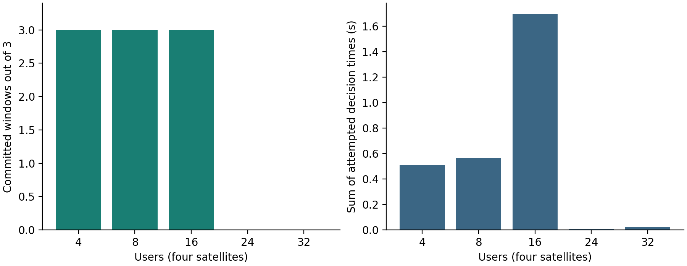
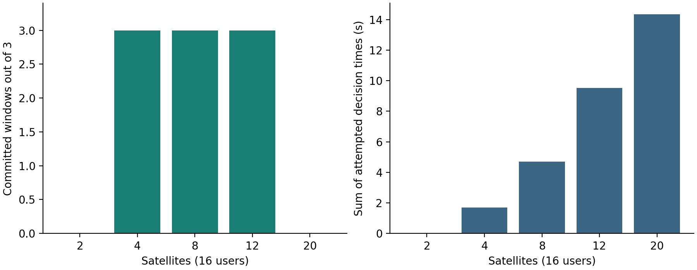
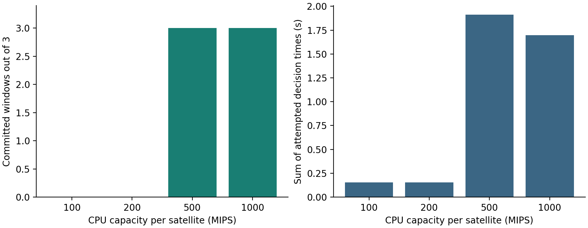
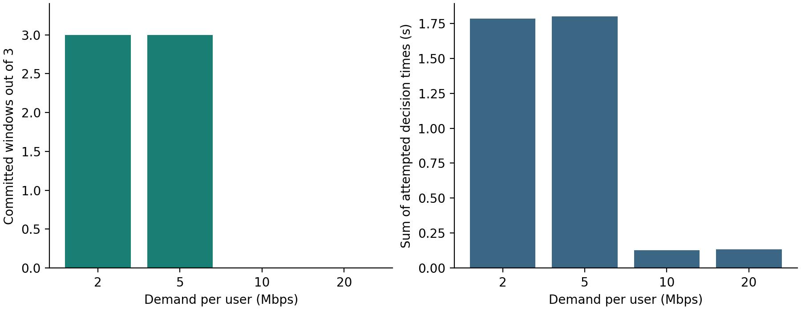
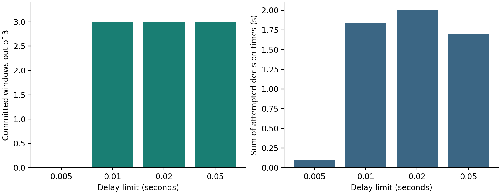
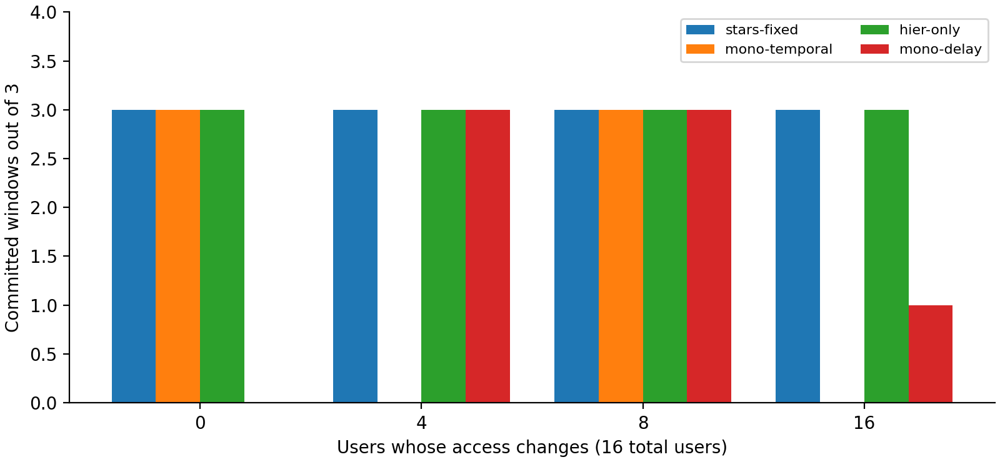
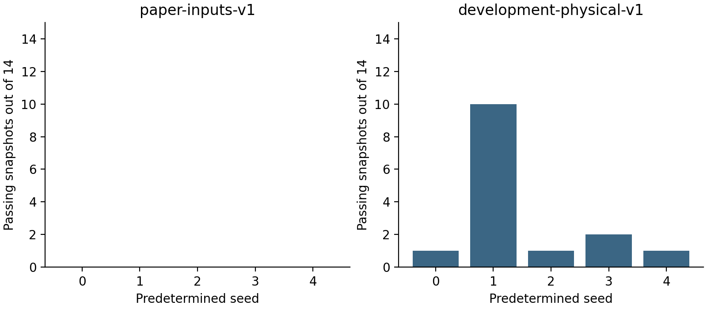

# Final experiment record and report-selection guide

This is a research evidence summary, not a finished submission report. All configured outcomes are retained. The code was frozen; only scenario inputs and experiment scripts were added.

## Results by scenario

| case | method | status | approved_windows | failure_reason | J | access_switches | host_moves | max_committed_delay_ms | decision_seconds | reused_from |
| --- | --- | --- | --- | --- | --- | --- | --- | --- | --- | --- |
| load-4 | stars-fixed | success | 3 |  | 2.8499999999999996 | 4 | 8 | 11.463419003813748 | 0.5107333999476396 |  |
| load-8 | stars-fixed | success | 3 |  | 1.4249999999999998 | 4 | 8 | 15.49529865087003 | 0.5648367999237962 |  |
| load-16 | stars-fixed | success | 3 |  | 0.7124999999999999 | 4 | 8 | 10.78194633703357 | 1.6973992999992333 |  |
| load-24 | stars-fixed | failed | 0 | stage1_no_reference:infeasible | 11.41 | 0 | 0 | None | 0.009650099964346737 |  |
| load-32 | stars-fixed | failed | 0 | stage1_no_reference:infeasible | 11.41 | 0 | 0 | None | 0.024156400002539158 |  |
| satellites-2 | stars-fixed | failed | 0 | stage1_no_reference:infeasible | 11.41 | 0 | 0 | None | 0.010542300005909055 |  |
| satellites-4 | stars-fixed | success | 3 |  | 0.7124999999999999 | 4 | 8 | 10.78194633703357 | 1.6973992999992333 | load-16 |
| satellites-8 | stars-fixed | success | 3 |  | 0.7124999999999999 | 4 | 8 | 11.481997302069992 | 4.696452300006058 |  |
| satellites-12 | stars-fixed | success | 3 |  | 0.7124999999999999 | 4 | 8 | 15.49529865087003 | 9.537110899982508 |  |
| satellites-20 | stars-fixed | failed | 0 | window_deadline_exceeded | 11.41 | 0 | 0 | None | 14.358951399975922 |  |
| handover-0 | stars-fixed | success | 3 |  | 0.0 | 0 | 0 | 9.944489998572793 | 1.7987099000019953 |  |
| handover-0 | mono-temporal | success | 3 |  | 0.0 | 0 | 0 | 7.054527327026982 | 9.822815300023649 |  |
| handover-0 | hier-only | success | 3 |  | 0.0 | 0 | 0 | 9.944489998572793 | 1.0395422000437975 |  |
| handover-0 | mono-delay | failed | 0 | window_deadline_exceeded | 11.41 | 0 | 0 | None | 10.090340700000525 |  |
| handover-4 | stars-fixed | success | 3 |  | 0.7124999999999999 | 4 | 8 | 10.78194633703357 | 1.6973992999992333 | load-16 |
| handover-4 | mono-temporal | failed | 0 | window_deadline_exceeded | 11.41 | 0 | 0 | None | 10.072920000005979 |  |
| handover-4 | hier-only | success | 3 |  | 0.7124999999999999 | 4 | 8 | 10.701271164331335 | 1.638944200007245 |  |
| handover-4 | mono-delay | success | 3 |  | 0.7124999999999999 | 4 | 8 | 6.392064698646752 | 28.206360800017137 |  |
| handover-8 | stars-fixed | success | 3 |  | 1.4249999999999998 | 8 | 16 | 10.989511459211093 | 1.2236568999942392 |  |
| handover-8 | mono-temporal | success | 3 |  | 1.4249999999999998 | 8 | 16 | 10.16718815484925 | 10.478215699957218 |  |
| handover-8 | hier-only | success | 3 |  | 1.4249999999999998 | 8 | 16 | 9.944489998572793 | 1.5504104999708943 |  |
| handover-8 | mono-delay | success | 3 |  | 1.4249999999999998 | 8 | 16 | 6.392064698646752 | 29.841562899993733 |  |
| handover-16 | stars-fixed | success | 3 |  | 2.8499999999999996 | 16 | 32 | 12.326716911588871 | 1.9497422999702394 |  |
| handover-16 | mono-temporal | failed | 0 | window_deadline_exceeded | 11.41 | 0 | 0 | None | 10.122875400003977 |  |
| handover-16 | hier-only | success | 3 |  | 2.8499999999999996 | 16 | 32 | 11.551539997595496 | 1.0835912000620738 |  |
| handover-16 | mono-delay | failed | 1 | timelimit | 7.409999999999999 | 0 | 0 | 6.392064698646752 | 18.6915333000361 |  |
| cpu-100 | stars-fixed | failed | 0 | infeasible | 11.41 | 0 | 0 | None | 0.15489620005246252 |  |
| cpu-200 | stars-fixed | failed | 0 | infeasible | 11.41 | 0 | 0 | None | 0.15558250003959984 |  |
| cpu-500 | stars-fixed | success | 3 |  | 0.7124999999999999 | 4 | 8 | 12.829997710187675 | 1.9115865999483503 |  |
| cpu-1000 | stars-fixed | success | 3 |  | 0.7124999999999999 | 4 | 8 | 10.78194633703357 | 1.6973992999992333 | load-16 |
| demand-2 | stars-fixed | success | 3 |  | 0.7124999999999999 | 4 | 8 | 15.551539997595496 | 1.7848626999766566 |  |
| demand-5 | stars-fixed | success | 3 |  | 0.7124999999999999 | 4 | 8 | 7.463532112890497 | 1.8013170998892747 |  |
| demand-10 | stars-fixed | failed | 0 | infeasible | 11.41 | 0 | 0 | None | 0.12579149997327477 |  |
| demand-20 | stars-fixed | failed | 0 | infeasible | 11.41 | 0 | 0 | None | 0.13434209994738922 |  |
| delay-0.005 | stars-fixed | failed | 0 | infeasible | 11.41 | 0 | 0 | None | 0.09499690000666305 |  |
| delay-0.01 | stars-fixed | success | 3 |  | 0.7124999999999999 | 4 | 8 | 9.814663412886471 | 1.8366861999966204 |  |
| delay-0.02 | stars-fixed | success | 3 |  | 0.7124999999999999 | 4 | 8 | 11.345539366467904 | 2.0003349999315105 |  |
| delay-0.05 | stars-fixed | success | 3 |  | 0.7124999999999999 | 4 | 8 | 10.78194633703357 | 1.6973992999992333 | load-16 |

## Physical seed sweep

| family | seed | necessary_passed | min_access_flow | max_access_flow | initial_passed | episode_status |
| --- | --- | --- | --- | --- | --- | --- |
| paper-inputs-v1 | 0 | 0 | 5 | 10 | False | preflight_failed_full_episode_not_solved |
| paper-inputs-v1 | 1 | 0 | 5 | 10 | False | preflight_failed_full_episode_not_solved |
| paper-inputs-v1 | 2 | 0 | 5 | 10 | False | preflight_failed_full_episode_not_solved |
| paper-inputs-v1 | 3 | 0 | 5 | 10 | False | preflight_failed_full_episode_not_solved |
| paper-inputs-v1 | 4 | 0 | 5 | 10 | False | preflight_failed_full_episode_not_solved |
| development-physical-v1 | 0 | 1 | 1 | 4 | False | preflight_failed_full_episode_not_solved |
| development-physical-v1 | 1 | 10 | 0 | 4 | True | preflight_failed_full_episode_not_solved |
| development-physical-v1 | 2 | 1 | 0 | 4 | True | preflight_failed_full_episode_not_solved |
| development-physical-v1 | 3 | 2 | 1 | 4 | False | preflight_failed_full_episode_not_solved |
| development-physical-v1 | 4 | 1 | 0 | 4 | False | preflight_failed_full_episode_not_solved |

## Significant findings to discuss

- load-4: 3/3 windows committed; success; reason=none; attempted decision time=0.511s.

- load-8: 3/3 windows committed; success; reason=none; attempted decision time=0.565s.

- load-16: 3/3 windows committed; success; reason=none; attempted decision time=1.697s.

- load-24: 0/3 windows committed; failed; reason=stage1_no_reference:infeasible; attempted decision time=0.010s.

- load-32: 0/3 windows committed; failed; reason=stage1_no_reference:infeasible; attempted decision time=0.024s.

- satellites-2: 0/3 windows committed; failed; reason=stage1_no_reference:infeasible; attempted decision time=0.011s.

- satellites-4: 3/3 windows committed; success; reason=none; attempted decision time=1.697s.

- satellites-8: 3/3 windows committed; success; reason=none; attempted decision time=4.696s.

- satellites-12: 3/3 windows committed; success; reason=none; attempted decision time=9.537s.

- satellites-20: 0/3 windows committed; failed; reason=window_deadline_exceeded; attempted decision time=14.359s.

## Larger-population boundary cases

```json
[
  {
    "case": "extended-users20-satellites4",
    "users": 20,
    "satellites": 4,
    "status": "success",
    "approved_windows": 3,
    "reason": "",
    "access_switches": 4,
    "host_moves": 8,
    "decision_seconds": 1.6395138000370935
  },
  {
    "case": "extended-users32-satellites8",
    "users": 32,
    "satellites": 8,
    "status": "success",
    "approved_windows": 3,
    "reason": "",
    "access_switches": 4,
    "host_moves": 8,
    "decision_seconds": 9.930758800008334
  },
  {
    "case": "extended-users64-satellites16",
    "users": 64,
    "satellites": 16,
    "status": "failed",
    "approved_windows": 0,
    "reason": "window_deadline_exceeded",
    "access_switches": 0,
    "host_moves": 0,
    "decision_seconds": 34.64209179999307
  }
]
```

## Actual physical episode attempts after initial coverage passed

```json
[
  {
    "family": "development-physical-v1",
    "seed": 1,
    "wall_seconds": 67.7446691999794,
    "exit": 0,
    "supervisor_reason": null,
    "episode_status": "failed",
    "approved_windows": 0,
    "window_statuses": [
      {
        "index": 0,
        "status": "failed",
        "reason": "timelimit"
      }
    ],
    "parent_pid_peak_bytes": 4927488,
    "memory_measurement_scope": "PID only; Windows venv launcher may have child processes; not a process-tree memory certificate"
  },
  {
    "family": "development-physical-v1",
    "seed": 2,
    "wall_seconds": 20.73965949995909,
    "exit": 0,
    "supervisor_reason": null,
    "episode_status": "failed",
    "approved_windows": 0,
    "window_statuses": [
      {
        "index": 0,
        "status": "failed",
        "reason": "infeasible"
      }
    ],
    "parent_pid_peak_bytes": 4935680,
    "memory_measurement_scope": "PID only; Windows venv launcher may have child processes; not a process-tree memory certificate"
  }
]
```

## Rotated-order runtime repetitions

| repeat | method | status | approved_windows | reason | decision_seconds |
| --- | --- | --- | --- | --- | --- |
| 0 | stars-fixed | success | 3 |  | 1.088794099923689 |
| 0 | mono-temporal | success | 3 |  | 9.882489799987525 |
| 0 | hier-only | success | 3 |  | 1.8673230999847874 |
| 0 | mono-delay | failed | 1 | timelimit | 19.265350799949374 |
| 1 | mono-temporal | success | 3 |  | 10.955227300000843 |
| 1 | hier-only | success | 3 |  | 1.5402452999260277 |
| 1 | mono-delay | failed | 1 | timelimit | 19.120878200046718 |
| 1 | stars-fixed | success | 3 |  | 1.349660399951972 |
| 2 | hier-only | success | 3 |  | 1.114096499979496 |
| 2 | mono-delay | failed | 1 | timelimit | 19.00734910002211 |
| 2 | stars-fixed | success | 3 |  | 1.917038900020998 |
| 2 | mono-temporal | success | 3 |  | 10.349466500047129 |

These repeat the same input; they measure run-to-run computational behavior rather than independent network conditions.

## How to select results for the report

Lead with the 16-user handover and Stage II rescue. Use native/shared-start comparisons to explain initialization. Use the handover-method matrix and one CPU/delay boundary figure for controlled stress evidence. Use the satellite sweep to explain capacity versus computation. Use the physical-seed plot to establish coverage limitations beyond seed 0. Use constructed X/Y and the aliased-state example to explain when adaptive weighting could help and when observations are insufficient. The smaller cases, complete tables and raw logs belong in appendices/archive rather than being discarded.

Do not claim universal STARS superiority. Identify cases where hierarchy-only or monolithic temporal ties STARS. Deadline outcomes are budget-specific and timings vary; repeated failure is not proof of mathematical infeasibility. Forced handovers do not establish learned-policy benefit. Native physical training and scientific held-out evaluation remain unavailable wherever readiness fails. Do not treat blocked training as completed.

J is normalized: the same four migrating users form a smaller fraction at 16 users than at eight. A smaller normalized J across population sizes is not fewer absolute migrations. Failed episodes have a penalty; observed switch and delay totals refer only to committed windows. Zero moves with zero deployments is not a stability success.

## Figures



Success and attempted decision cost. Failed episodes terminate early, so their timing is not full-episode runtime. Single measured run per unique input.



Success and attempted decision cost. Failed episodes terminate early, so their timing is not full-episode runtime. Single measured run per unique input.



Success and attempted decision cost. Failed episodes terminate early, so their timing is not full-episode runtime. Single measured run per unique input.



Success and attempted decision cost. Failed episodes terminate early, so their timing is not full-episode runtime. Single measured run per unique input.



Success and attempted decision cost. Failed episodes terminate early, so their timing is not full-episode runtime. Single measured run per unique input.



Completion under the same 10-second per-window budget and native initialization. These methods have different objectives; this is a method-package comparison.



All five seeds retained per family. Necessary coverage/resource checks are not sufficient for a complete feasible deployment. Seeds are layout/load perturbations of the same geometry, not five independent orbital designs.