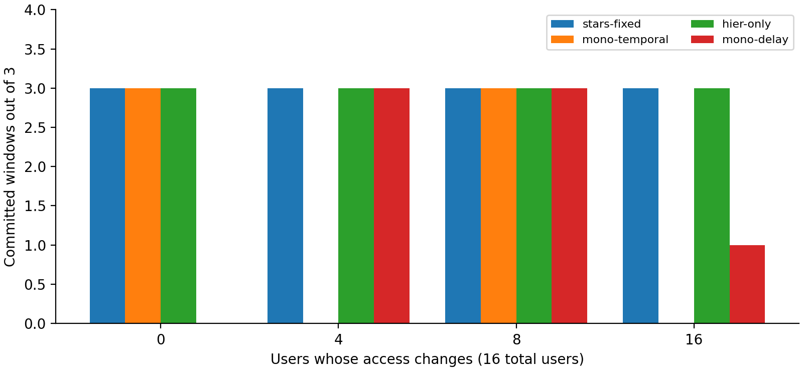
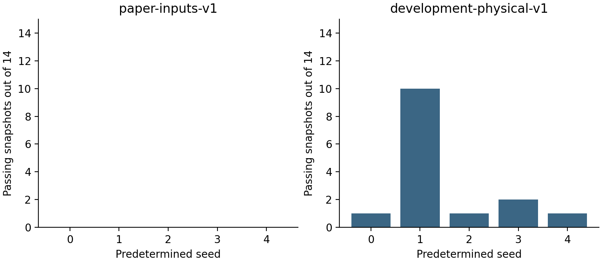
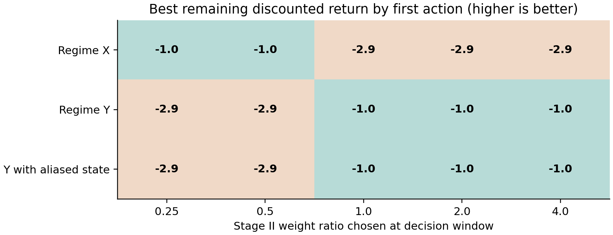

# Experiment results

The tables and figures summarize the measured experiments. Both successful and failed cases are included.

- `authored-results.csv`: user-load, satellite-count, handover, CPU, demand and delay sweeps.
- `physical-results.csv`: both frozen physical families, seeds 0–4.
- `action-returns.csv`: constructed weight-selection cases, including an aliased observation.

Thirty-two users on eight authored satellites completed three windows. The sixty-four-user case missed its first decision deadline. In three repetitions of the sixteen-user handover, STARS completed all episodes; hierarchy-only performed similarly, temporal monolithic used more decision time, and delay-only did not complete.

No tested physical trace passed all fourteen necessary checks. Two initially passing development traces were attempted with the full optimizer: one timed out and one was infeasible. The RL action experiment demonstrates a weight trade-off; it is not a trained-policy improvement.

Authored connectivity and physical orbital traces are different experiments. Timings are case-study measurements, not universal performance guarantees. See [experiment instructions](../README.md) for parameters and execution.

